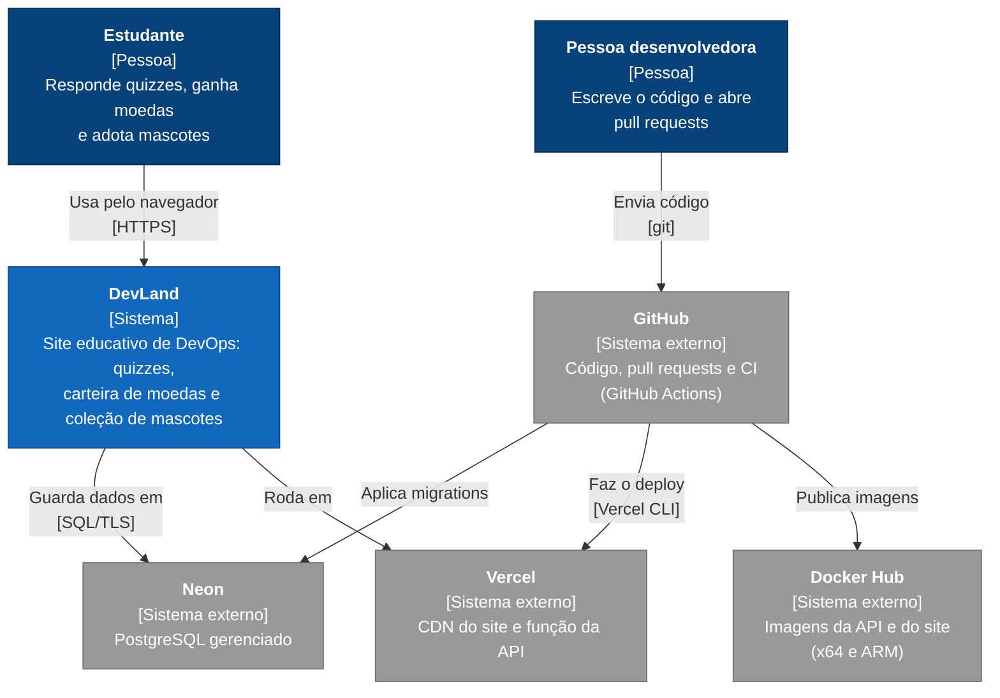
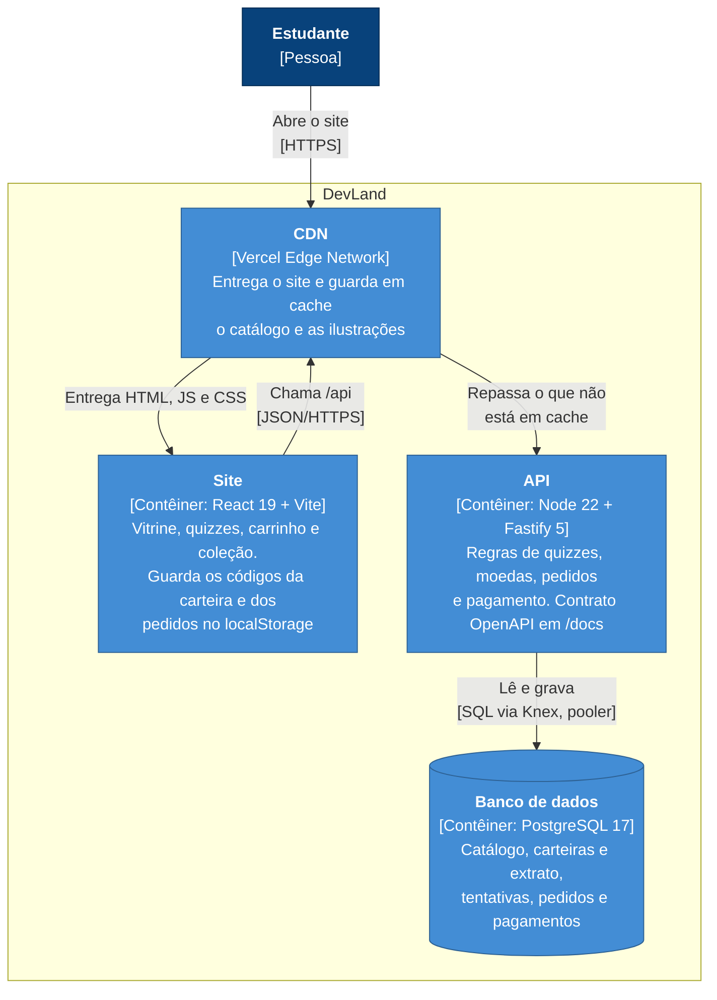
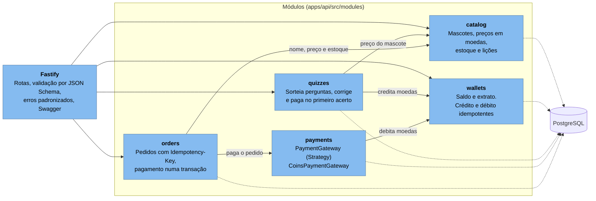

# Arquitetura em C4

Três níveis do [modelo C4](https://c4model.com/): o sistema no mundo (contexto), as peças que
rodam (contêineres) e os módulos da API (componentes). As decisões por trás de cada escolha estão
nos [ADRs](../adr/README.md).

## Nível 1: contexto

Quem usa o DevLand e com quais sistemas ele conversa.

Não há login nem cadastro: a carteira e os pedidos são identificados por UUID, guardados no
navegador. O sistema não pede nenhum dado pessoal nem de pagamento.

## Nível 2: contêineres

As peças que rodam e como conversam em produção, onde site e API ficam no mesmo domínio (`/api`),
sem CORS. Com `docker compose up`, as mesmas peças rodam em contêineres: o nginx entrega o site
(porta 8080) e o site chama a API direto (porta 3333), com CORS restrito à origem do site.

| Contêiner | Produção                               | Docker Compose                             |
| --------- | -------------------------------------- | ------------------------------------------ |
| Site      | Arquivos estáticos na CDN da Vercel    | `devland-web` (nginx sem root, porta 8080) |
| API       | Função da Vercel em São Paulo (`gru1`) | `devland-api` (Node sem root, porta 3333)  |
| Banco     | Neon em São Paulo (`aws-sa-east-1`)    | `postgres:17-alpine` com volume            |

## Nível 3: componentes da API

O monólito modular por dentro. Cada módulo é dono das próprias tabelas e só usa outro pela
interface exportada no `index.ts`. A composição (`app.ts`) liga as dependências.

Dentro de cada módulo, as camadas seguem a mesma direção: `routes` (HTTP e schema) → `service`
(regra de negócio) → `repository` (interface e implementação com Knex). O service depende só da
interface do repository, por isso é testado sem banco.
