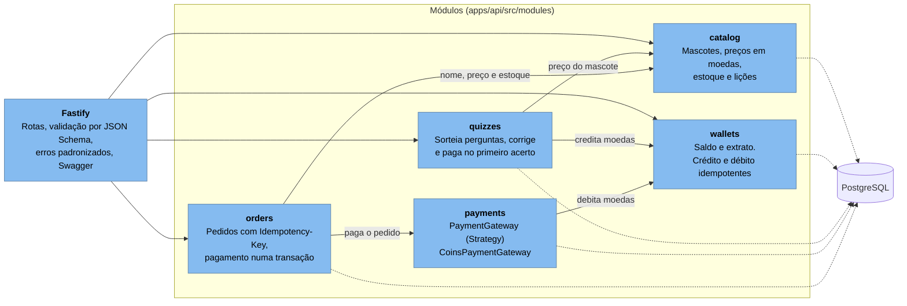

# Componentes da API (C4, nível 3)

O monólito modular por dentro. Cada módulo é dono das próprias tabelas e só usa outro pela
interface exportada no `index.ts`. A composição (`app.ts`) liga as dependências.

Dentro de cada módulo, as camadas seguem a mesma direção: `routes` (HTTP e schema) → `service`
(regra de negócio) → `repository` (interface e implementação com Knex). O service depende só da
interface do repository, por isso é testado sem banco.
