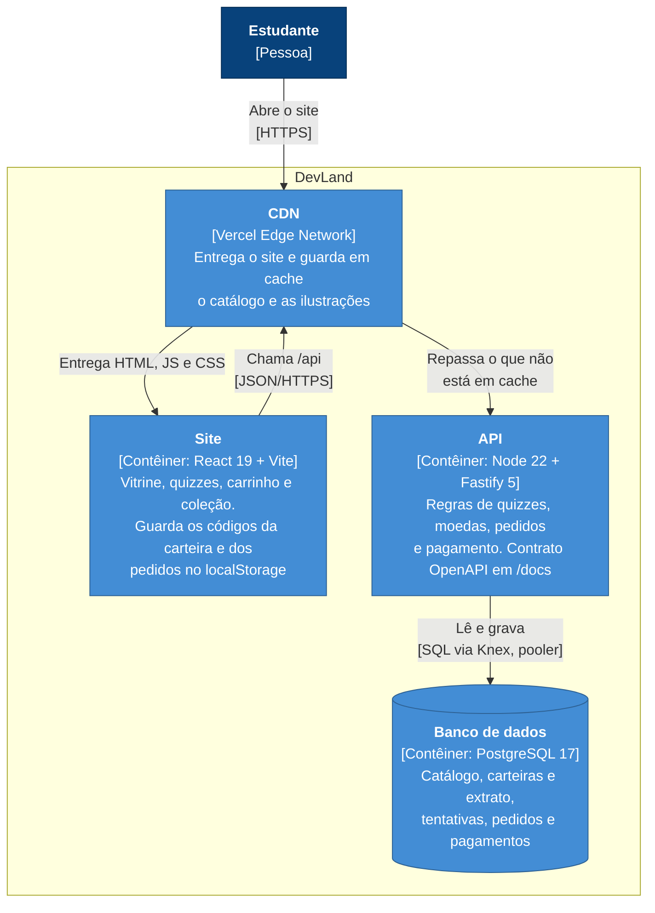

# Contêineres (C4, nível 2)

As peças que rodam e como conversam em produção, onde site e API ficam no mesmo domínio (`/api`),
sem CORS. Com `docker compose up`, as mesmas peças rodam em contêineres: o nginx entrega o site
(porta 8080) e o site chama a API direto (porta 3333), com CORS restrito à origem do site.

| Contêiner | Produção                               | Docker Compose                             |
| --------- | -------------------------------------- | ------------------------------------------ |
| Site      | Arquivos estáticos na CDN da Vercel    | `devland-web` (nginx sem root, porta 8080) |
| API       | Função da Vercel em São Paulo (`gru1`) | `devland-api` (Node sem root, porta 3333)  |
| Banco     | Neon em São Paulo (`aws-sa-east-1`)    | `postgres:17-alpine` com volume            |
