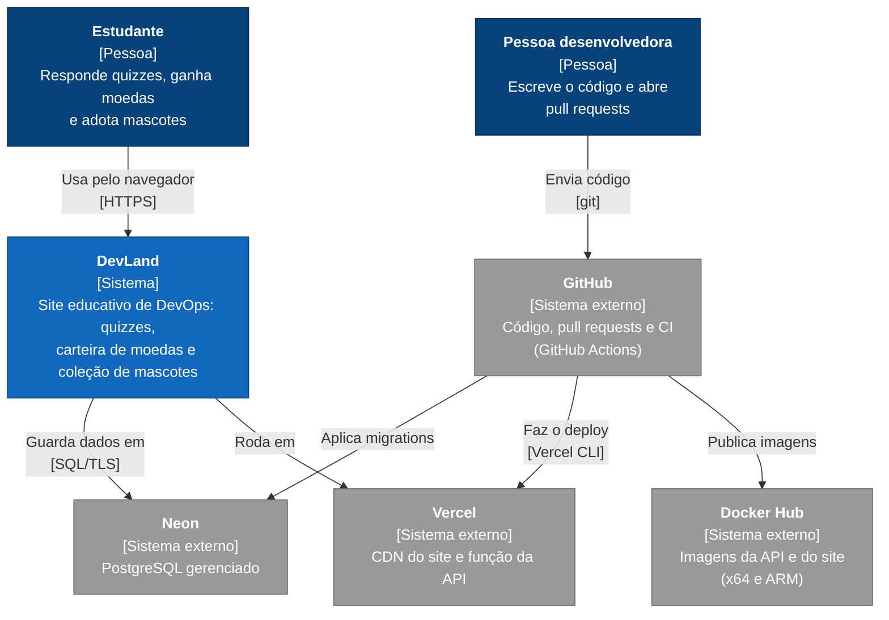

# Contexto (C4, nível 1)

Quem usa o DevLand e com quais sistemas ele conversa.

Não há login nem cadastro: a carteira e os pedidos são identificados por UUID, guardados no
navegador. O sistema não pede nenhum dado pessoal nem de pagamento.
