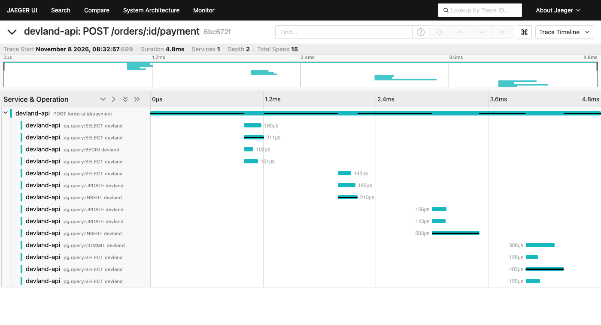

# Desempenho e observabilidade

Um objetivo de serviço (SLO) declarado, uma métrica que mostra se ele está sendo cumprido, um teste
de fumaça que mede a latência de verdade, local e em produção, um teste de carga com o gargalo antes
e depois, e um trace de um pagamento.

## SLO

| Sinal    | Indicador (SLI)                                     | Objetivo (SLO)       |
| -------- | --------------------------------------------------- | -------------------- |
| Latência | Duração das requisições à API                       | 95% abaixo de 500 ms |
| Erros    | Requisições que falham (status 5xx ou sem resposta) | Menos de 1%          |

**Por que 500 ms:** cada clique no site (abrir a vitrine, começar um quiz, responder, adotar) é uma
chamada à API. Um segundo é o limite clássico para a pessoa não perder o fio do que está fazendo;
500 ms para a API deixa a outra metade para a rede do celular e para a tela se atualizar. A API
responde em poucos milissegundos no Docker e na casa de 100 a 250 ms em produção (medidos abaixo),
então o objetivo tem folga.

**Onde o SLO é conferido:**

- **No CI, a cada pull request:** o teste de fumaça roda contra o `docker compose`. O SLO é limite
  (threshold) do k6: se o p95 passar de 500 ms ou houver mais de 1% de erro, o pipeline falha.
- **Em produção:** o mesmo teste, em modo só leitura, e a métrica `/api/metrics`.

## Métrica

`GET /metrics` (em produção, `/api/metrics`) devolve as métricas no formato de texto do
Prometheus. A métrica da aplicação é uma só, `http_request_duration_seconds`, um histograma com três
rótulos:

- `method`: GET, POST...
- `route`: o molde da rota (`/orders/:id`), nunca a URL. Com o id, cada pedido criaria uma série
  nova, e a memória cresceria sem limite. Rotas que não existem ficam como `unmatched`.
- `status_code`: o status da resposta.

```text
http_request_duration_seconds_bucket{le="0.5",method="GET",route="/products",status_code="200"} 120
http_request_duration_seconds_bucket{le="+Inf",method="GET",route="/products",status_code="200"} 120
http_request_duration_seconds_sum{method="GET",route="/products",status_code="200"} 0.193
http_request_duration_seconds_count{method="GET",route="/products",status_code="200"} 120
```

Do mesmo histograma saem os três sinais do método RED (taxa, erros e duração) e o cumprimento do
SLO. Uma das faixas é exatamente 0,5 s, o limite do SLO, para que a conta seja direta:

| Pergunta                                 | Consulta (PromQL)                                                                                                             |
| ---------------------------------------- | ----------------------------------------------------------------------------------------------------------------------------- |
| Quantas requisições por segundo? (taxa)  | `sum(rate(http_request_duration_seconds_count[5m]))`                                                                          |
| Que fração falha? (erros)                | `sum(rate(http_request_duration_seconds_count{status_code=~"5.."}[5m])) / sum(rate(http_request_duration_seconds_count[5m]))` |
| Qual o p95? (duração)                    | `histogram_quantile(0.95, sum by (le) (rate(http_request_duration_seconds_bucket[5m])))`                                      |
| Que fração ficou abaixo de 500 ms? (SLO) | `sum(rate(http_request_duration_seconds_bucket{le="0.5"}[5m])) / sum(rate(http_request_duration_seconds_count[5m]))`          |

A resposta também traz as métricas padrão do processo Node (CPU, memória, atraso do event loop).
A coleta (`/metrics`) não entra na conta, e a resposta nunca vai para o cache da CDN.

**Limitação na Vercel:** a API roda como função, e cada instância conta só as requisições que
passaram por ela; uma instância nova começa do zero. Para somar todas, as instâncias teriam de
enviar as métricas para um coletor externo (por exemplo, OpenTelemetry com Grafana Cloud). No
Docker há uma instância só, e a métrica é completa.

## Teste de fumaça (k6)

[`perf/smoke.js`](../perf/smoke.js): 2 usuários virtuais por 30 segundos. Cada um consulta a saúde,
a vitrine e a lista de quizzes, começa uma tentativa de quiz e espera 1 segundo, como alguém
navegando. É um teste de fumaça: confirma que o sistema responde dentro do SLO com pouca carga. Não
mede o limite do sistema.

```bash
# Local: sobe banco e API, se ainda não estiverem no ar, e roda o teste
docker compose --profile perf run --rm k6

# Produção, só leitura (não cria carteiras nem tentativas no banco de verdade)
docker compose --profile perf run --rm --no-deps \
  -e BASE_URL=https://devland-app.vercel.app/api -e READ_ONLY=1 k6
```

O k6 roda pela imagem oficial, definida no `docker-compose.yml` com o perfil `perf`: não precisa
instalar nada, e o comando é o mesmo em macOS, Linux e Windows.

### Resultados (7 de novembro de 2026)

p95 por rota, medido pelo k6 (do lado de quem chama):

| Rota                             | Docker local |     Produção |
| -------------------------------- | -----------: | -----------: |
| `GET /health` (consulta o banco) |      4,42 ms |     229,3 ms |
| `GET /products`                  |      3,33 ms |     157,6 ms |
| `GET /quizzes`                   |      3,84 ms |     201,2 ms |
| `POST /quizzes/:slug/attempts`   |      8,52 ms |            — |
| **Todas**                        |  **6,00 ms** | **204,0 ms** |
| Requisições / erros              |      241 / 0 |      132 / 0 |

- **Docker local:** API, banco e k6 na mesma máquina, sem rede no meio. A própria métrica da API
  confirma: a vitrine levou em média 1,6 ms dentro da API (`_sum / _count`), contra 2,2 ms medidos
  pelo k6.
- **Produção:** medido pela internet, da máquina de desenvolvimento até a Vercel em São Paulo. A
  maior parte do tempo é o caminho pela rede. A vitrine vem do cache da CDN, sem passar pela
  função, e tem mediana de 108 ms; a saúde passa pela função e pelo banco e tem 126 ms. Função e
  banco somam uns 18 ms; o resto é a ida e volta até São Paulo. A tentativa de quiz fica de fora
  para não gravar dados de teste no banco de produção.

### Banco que dorme

O Neon gratuito suspende o banco depois de 5 minutos sem uso. A primeira requisição que consulta o
banco depois disso espera ele acordar:

| Requisição a `/api/health` depois de 7 minutos sem acesso | Tempo total |
| --------------------------------------------------------- | ----------: |
| Primeira (função e banco acordando)                       |      1,49 s |
| Segunda                                                   |      0,33 s |
| Terceira                                                  |      0,33 s |

Medido com `curl`, que abre uma conexão nova a cada chamada: por isso as requisições já acordadas
levam mais que no k6, que reaproveita a conexão. O 1,49 s inclui acordar a função e o banco.

Como acontece só depois de um período sem acesso, essa espera fica fora dos 95% mais rápidos de
um uso normal, mas é o pior caso de quem chega a um site vazio.

## Teste de carga (k6, 3 estágios)

[`perf/load.js`](../perf/load.js) sobe a carga (15 s), sustenta no patamar (40 s) e desce (15 s), com
o banco já cheio: 100 mil pedidos sintéticos, cerca de 70% pagos, e 200 carteiras
([`perf/seed-orders.sql`](../perf/seed-orders.sql)). Cada usuário virtual faz o caminho de quem adota
um mascote: vitrine, quizzes, um pedido antigo sorteado, um pedido novo e o pagamento dele.

```bash
docker compose up --build --wait db api
docker compose --profile perf run --rm seed
docker compose --profile perf run --rm k6 run /perf/load.js          # 800 usuários
docker compose --profile perf run --rm -e VUS=1400 k6 run /perf/load.js
```

O teste grava no banco: rode só no compose, nunca em produção. Para não misturar com o banco de
desenvolvimento, use outro projeto e outras portas (`docker compose -p devland-perf`, com `API_PORT`,
`WEB_PORT` e `DB_PORT` diferentes), e apague depois com `down -v`.

**Ambiente:** Docker Desktop no macOS, 15 CPUs e 7,7 GB, com API, banco e k6 na mesma máquina. Os
números servem para comparar antes e depois, não como capacidade da produção. Cada rodada começou de
um banco novo, com os 100 mil pedidos e um aquecimento de 200 usuários (o JIT do Node começa frio).

### Como o gargalo foi encontrado

1. **Subindo a carga** de 60 a 1.400 usuários, a vazão cresceu até cerca de 3.000 requisições por
   segundo e parou: de 800 para 1.400 usuários, ela ficou igual, e a latência multiplicou por 9.
2. **CPU dos containers no patamar:** API em cerca de 115% (um núcleo cheio, o Node atende em uma
   thread), banco em 90% e k6 em 35%. O limite não era o gerador de carga.
3. **Perfil de CPU da API** (`node --cpu-prof`): nenhuma função pesada. O tempo vai em escrita em
   socket e no Knex, ou seja, na conversa com o banco.
4. **`EXPLAIN ANALYZE`** com 191 mil pedidos: as consultas por id, por `Idempotency-Key` e de
   pagamento usam índice e levam de 0,02 a 0,04 ms. O volume não era o problema.
5. **`pg_stat_statements`** mostrou o culpado: um único comando somava 63% de todo o tempo de banco.

```sql
update "products" set "stock" = "stock" - $1 where "id" = $2 and "stock" >= $3
-- 84.247 execuções, 41,8 s no total, 0,496 ms em média (as outras: de 0,009 a 0,038 ms)
```

**O gargalo era espera de trava numa linha quente.** Cada pagamento atualiza a linha de um mascote,
são só 9 linhas, e a trava só é solta no fim da transação. A baixa de estoque vinha logo no começo,
então a trava ficava presa durante todos os passos seguintes: débito, extrato, pagamento e pedido
pago. Cada pagamento esperava os anteriores do mesmo mascote, ocupando uma das 10 conexões do pool.

**A correção** foi mudar a ordem: a baixa de estoque passou a ser o último passo da transação. A
regra não muda, porque continua tudo numa transação só: se o estoque falhar, o débito é desfeito. A
ordem das travas continua igual para todos (pedido, carteira, mascotes em ordem de id), o que evita
deadlock. A única diferença visível: sem moedas e com o mascote esgotado ao mesmo tempo, a resposta
agora é 402 em vez de 409.

### Antes e depois

Uma rodada de cada, com 0 erro em todas.

| 800 usuários (abaixo do limite) |    Antes |  Depois |
| ------------------------------- | -------: | ------: |
| p95 geral                       |  58,0 ms | 26,4 ms |
| p95 `POST /orders/:id/payment`  | 101,3 ms | 36,7 ms |
| p95 `POST /orders`              |  98,6 ms | 34,4 ms |
| p95 `GET /orders/:id`           |  39,0 ms | 13,8 ms |
| p95 `GET /products`             |  20,6 ms |  7,5 ms |
| Requisições por segundo         |    2.868 |   3.040 |

| 1.400 usuários (saturado)      |    Antes |   Depois |
| ------------------------------ | -------: | -------: |
| p95 geral                      | 397,6 ms | 416,8 ms |
| p95 `POST /orders/:id/payment` | 417,7 ms | 496,9 ms |
| Requisições por segundo        |    3.082 |    3.027 |

| Banco, somando as duas cargas |    Antes |   Depois |
| ----------------------------- | -------: | -------: |
| Tempo na baixa de estoque     |   41,8 s |    2,5 s |
| Média da baixa de estoque     | 0,496 ms | 0,029 ms |
| Tempo total de banco          |   66,1 s |   26,7 s |

A 800 usuários, o p95 caiu 55%, e até as leituras melhoraram, provavelmente porque deixaram de
esperar por uma conexão ocupada. A 1.400 usuários não houve ganho: a diferença é pequena e veio de uma rodada só. Ali o
limite já é outro.

### O próximo gargalo

O processo Node usa um núcleo e satura perto de 3.000 requisições por segundo, ainda dentro do SLO
(p95 abaixo de 500 ms) e sem erros. Não apliquei `cluster` porque a produção não roda um processo só:
a Vercel distribui as requisições entre instâncias da função. Nesse cenário, a tendência é a CPU deixar
de ser o limite e a concorrência no banco crescer, e é aí que a correção da linha quente importa.

## Plano de p95

O objetivo é o do SLO: 95% das requisições abaixo de 500 ms. O plano tem três partes.

**1. Cache com tolerância, na CDN.** Na vitrine, um dado alguns segundos velho não prejudica ninguém,
então o catálogo responde com `s-maxage=30, stale-while-revalidate=300`: a CDN serve a mesma resposta
por 30 segundos e, depois disso, ainda por até 5 minutos enquanto busca uma nova em segundo plano. A
vitrine continua respondendo sem acordar a função nem o banco.

A tolerância tem limite: um preço ou estoque pode aparecer atrasado na vitrine, mas nunca vale na
hora da compra. O preço do pedido vem do banco, o estoque é conferido ao criar o pedido e baixado no
pagamento. Respostas de erro não entram no cache, e as ilustrações ficam guardadas por um ano, porque
o endereço muda quando o desenho muda.

**2. Idempotência em toda escrita que pode se repetir.** Clique duplo e nova tentativa da rede são o
que uma fila teria de tratar, e já são tratados no banco, com índices únicos:

| Repetição                         | Garantia                                           |
| --------------------------------- | -------------------------------------------------- |
| Mesmo pedido enviado de novo      | `Idempotency-Key` única: devolve o pedido já feito |
| Mesmo acerto de quiz ou pagamento | Referência única no extrato: a carteira não mexe   |
| Pagar o mesmo pedido duas vezes   | Um único pagamento aprovado por pedido             |

**3. Fila: avaliada e descartada, por enquanto.** O pagamento é local, leva milissegundos e a pessoa
precisa do resultado na hora, então uma fila só acrescentaria um broker e um worker sempre ligados,
que não rodam numa função serverless. A decisão está no
[ADR 0003](adr/0003-pagamento-transacao-sem-fila.md). Ela muda se o pagamento passar a depender de um
sistema externo, e aí as garantias da tabela acima são o que torna o consumo da fila seguro.

**Resultado medido:** p95 de 204 ms em produção no teste de fumaça e de 26 ms no teste de carga com
800 usuários, ambos dentro do objetivo.

## Trace (OpenTelemetry e Jaeger)

A métrica diz quanto uma rota demora; o trace mostra onde o tempo foi, numa requisição específica.

```bash
docker compose -f docker-compose.yml -f compose.tracing.yaml up --build
# interface em http://localhost:16686, serviço devland-api
```



O trace acima é de um pagamento real: 4,8 ms no total, com 14 comandos SQL. Cada linha é uma ida ao
banco, com o texto da consulta nos detalhes. Ele confirma de outro ângulo o que o perfil de CPU
indicou no teste de carga: o custo do pagamento está em quantas vezes a API conversa com o banco.

O tracing só existe na imagem Docker, e só liga com `OTEL_EXPORTER_OTLP_ENDPOINT` configurado
(`src/tracing.ts`). A função da Vercel não importa esse arquivo, de propósito: uma dependência
nova nesse caminho já derrubou a API em produção uma vez (veja o `CLAUDE.md`).
